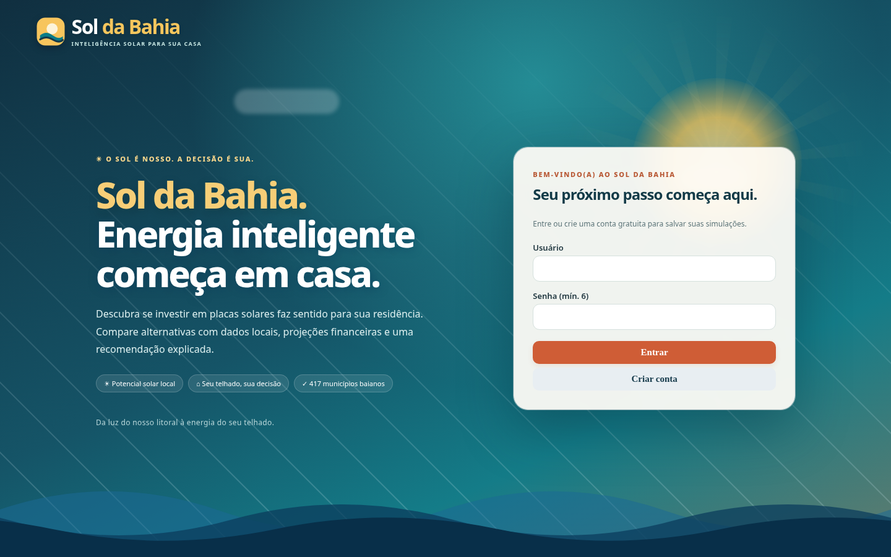

# ☀️ Sol da Bahia

**Sistema de Apoio à Decisão (SAD) para avaliar a instalação de energia solar fotovoltaica em residências da Bahia.**



A marca *Sol da Bahia* combina a luz solar, o azul do mar e cores quentes que remetem à cultura baiana. O protótipo não é um orçamento nem um projeto de engenharia: ele ajuda o morador a comparar opções tecnicamente admissíveis e economicamente estimadas, **incluindo a opção de não instalar**.

## Comece em 3 passos

Pré-requisitos: Python 3.12+ e internet para carregar a biblioteca de gráficos e a fonte web na interface.

```bash
# 1. Entre na pasta do projeto
cd sol_da_bahia_residencial

# 2. Instale as dependências
python -m pip install -r requirements.txt

# 3. Execute
python -m uvicorn app:app --reload
```

Abra **http://127.0.0.1:8000**, clique em **Criar conta** e cadastre um usuário para demonstração. Não existe senha padrão nem credenciais hardcoded no repositório.

No Windows, o mesmo procedimento funciona no PowerShell. Para publicar no Render: serviço **Web Service** em Python, comando de instalação `pip install -r requirements.txt` e comando de início `uvicorn app:app --host 0.0.0.0 --port $PORT`. O SQLite é salvo localmente; sem disco persistente, cadastros e históricos podem desaparecer em reinicializações. Para o trabalho acadêmico, use conta de demonstração e evite dados pessoais reais no ambiente público.

## Demonstração rápida

Na aba **Simulação**, informe:

| Campo | Exemplo didático |
|---|---|
| Município | Salvador |
| Consumo mensal | 250 kWh |
| Tarifa de energia B1 | R$ 0,87773/kWh, valor homologado **sem tributos** (Coelba, vigência 22/04/2026–21/04/2027) |
| Área **útil** do telhado | 30 m² |
| Perfil | Equilibrado (45% do consumo durante o dia) |
| Ligação | Bifásica (50 kWh de disponibilidade) |
| Modalidade tarifária | B1 convencional |
| Pagamento | À vista, sem cotação de financiamento |

Clique em **Analisar minha residência**. O sistema calcula a geração, testa sistemas com **número inteiro de módulos ilustrativos de 620 Wp**, respeita o limite da área informada (7 m²/kWp, hipótese simplificada), projeta a conta, o fluxo financeiro e o risco, compara alternativas e indica uma recomendação multicritério. Uma instalação real exige conferência de módulos/inversor, sombreamento, estrutura, conexão e orçamento.

**Tarifa Social:** o formulário oferece uma opção de cálculo **simplificado** que impede tratar os primeiros 80 kWh/mês como economia evitável. Não representa todos os impostos, descontos ou regras de elegibilidade. A decisão financeira nesses casos deve ser interpretada com especial cautela. O preço da tarifa social não é substituído automaticamente: informe um valor de referência compatível com a fatura e a modalidade.

## O que faz do protótipo um SAD?

1. **Regressão** estima o potencial mensal de geração usando irradiação (`ghi`), fração difusa e temperatura média, a partir de uma base de **417 municípios baianos × 12 meses**. A regressão aproxima **geração simulada**, não energia medida em telhados reais.
2. **Sumarização** calcula consumo, geração, custo, economia, VPL, TIR, payback e resumos de **Monte Carlo** (cenários, percentis e chance de VPL positivo).
3. **Agrupamento** separa as alternativas com indicadores SAW próximos mediante **agrupamento hierárquico**, cuja distância de corte deriva da sensibilidade dos pesos. O agrupamento não é uma pesquisa de perfis residenciais reais.
4. **Modelo de decisão:** filtro de viabilidade (VPL e probabilidade de VPL positivo), classificação das opções por **SAW** com pesos ajustados pela prioridade declarada e comparação com a alternativa **Não instalar**.

O SAD não obriga a instalar só porque a geração é tecnicamente possível. Sistemas que não cabem na área fornecida não são considerados.

## Estrutura

| Arquivo/pasta | Finalidade |
|---|---|
| `app.py` | API FastAPI, autenticação local, análises e histórico |
| `static/index.html` | Interface com identidade baiana e marca em destaque |
| `financeiro.py` | Área, módulos, geração, créditos mensais, custos, payback, VPL |
| `montecarlo.py` | Incerteza e estatísticas de cenários |
| `saw.py` | Viabilidade, SAW, sensibilidade, agrupamento, recomendação |
| `parametros.py` | Premissas e referências; recria `parametros_premissas.csv` |
| `dados/` | Base municipal, regressão e validação agrupada por município |
| `docs/FUNDAMENTACAO.md` | Definição do problema, variáveis, três funções e regras de decisão |
| `docs/CASO_E_VALIDACAO.md` | Caso ilustrativo e procedimento de validação |
| `docs/FLUXO.md` | Diagrama Mermaid de arquitetura e decisão |
| `docs/ENTREGA.md` | Checklist do PDF, links, vídeo e apresentação |
| `tests/` | Testes unitários e de integração |

Os arquivos em `modelos/` e `perfis.py` pertencem a **experimentos offline herdados** da fase anterior do trabalho. Não são necessários à recomendação residencial atual e não devem ser apresentados como análise de amostra real de residências.

## Testes e reprodutibilidade

```bash
python -m pip install -r requirements-dev.txt
python -m pytest -q
python scripts/validar_regressao.py
python scripts/caso_demonstracao.py
python parametros.py
```

A execução de `scripts/caso_demonstracao.py` recria o relatório de teste residencial em `docs/CASO_E_VALIDACAO.md` (dados **hipotéticos**, sem identificação de moradores). Com qualquer alteração de premissas, rode os testes e regenere a documentação numérica.

## Referências e limitações

- COSTA, F. F. A. et al. *Avaliação do payback em sistemas fotovoltaicos on-grid para consumidores residenciais grupo B1 sob a Lei 14300/2022*. Revista Brasileira de Energia Solar, v. XVI, n. 2, p. 147–157, dez. 2025. Referência para simultaneidade residencial, investimento por Wp e análise de retorno.
- NEOENERGIA COELBA. *Tarifas de Energia Elétrica — Grupo B*. Resolução Homologatória ANEEL nº 3.578/2026, vigência 22/04/2026–21/04/2027. B1 convencional: TUSD R$ 0,62008 e TE R$ 0,25765/kWh; soma R$ 0,87773/kWh, **sem tributos/encargos adicionais**.
- BRASIL. Lei nº 14.300/2022 (marco legal da geração distribuída). Os percentuais de 2026, 2027 e 2028 seguem o cronograma legal; **100% do Fio B depois de 2028 é uma hipótese conservadora**, não a redação literal da lei.
- HOLMGREN, W. F.; HANSEN, C. W.; MIKOFSKI, M. A. *pvlib python: a python package for modeling solar energy systems*. JOSS, 2018.
- Ver também [`docs/FUNDAMENTACAO.md`](docs/FUNDAMENTACAO.md) e [`docs/CASO_E_VALIDACAO.md`](docs/CASO_E_VALIDACAO.md).

**Limitações centrais:** tarifa simplificada, impossibilidade de substituir projeto elétrico ou orçamento; consumo residencial mensal uniforme; ausência de curvas de carga horárias, sombreamento, orientação do telhado e restrições do inversor; previsão solar baseada em simulações; cenários e parâmetros sujeitos a incerteza. O sistema pode recomendar **não instalar** ou indicar ressalvas.

**Privacidade:** nenhuma conta de energia pessoal, endereço residencial, CPF, número de instalação ou credencial real foi incluído neste projeto.
