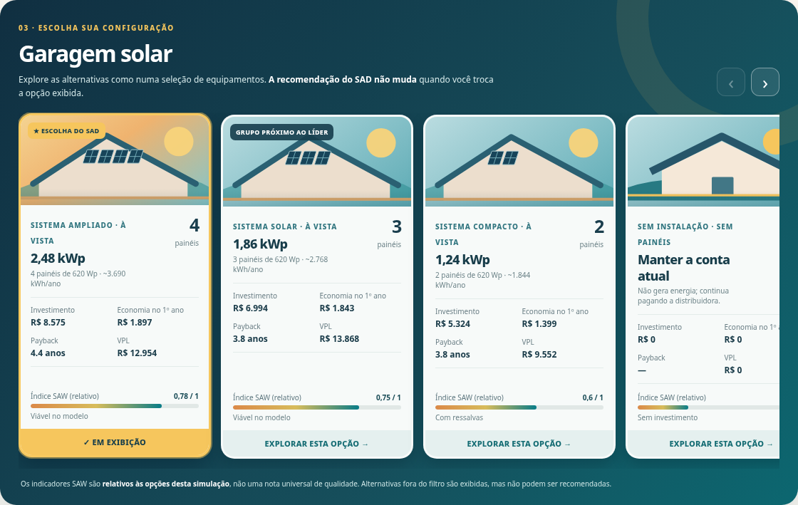

# ☀️ Sol da Bahia

**Sistema de Apoio à Decisão (SAD) para avaliar a instalação de energia solar fotovoltaica em residências da Bahia.**



A marca *Sol da Bahia* combina a luz solar, o azul do mar e cores quentes que remetem à cultura baiana. O protótipo não é um orçamento nem um projeto de engenharia: ele ajuda o morador a comparar opções tecnicamente admissíveis e economicamente estimadas, **incluindo a opção de não instalar**.

## Acesso para avaliação

- [Protótipo publicado](https://sad-solar.onrender.com/)
- [Vídeo demonstrativo](https://youtu.be/6mBe-Tpuimo)
- Usuário e senha de demonstração: consulte o PDF entregue à banca.

## Executar localmente

Use Python 3.12. A interface carrega a fonte e a biblioteca de gráficos pela internet.
Na raiz do repositório, execute no PowerShell:

```powershell
cd sad_solar
py -3.12 -m venv .venv
.\.venv\Scripts\python.exe -m pip install -r requirements.txt
.\.venv\Scripts\python.exe -m uvicorn app:app
```

No Linux ou macOS:

```bash
cd sad_solar
python3.12 -m venv .venv
.venv/bin/python -m pip install -r requirements.txt
.venv/bin/python -m uvicorn app:app
```

Abra **http://127.0.0.1:8000**. Para uma execução local sem variáveis de demonstração, clique em **Criar conta** e cadastre um usuário de teste.

### Publicação no Render

O Blueprint está em [`sad_solar/render.yaml`](render.yaml), usa `rootDir: sad_solar`, instala com `pip install -r requirements.txt` e executa `python -m uvicorn app:app --host 0.0.0.0 --port $PORT`.

Configure `DEMO_USER` e `DEMO_PASSWORD` no ambiente do serviço para recriar uma conta de demonstração quando o banco estiver vazio. Use um usuário com 3 a 40 caracteres e uma senha com 6 a 100 caracteres. Se o usuário já existir, a inicialização preserva a senha e os dados atuais. Guarde os valores na configuração do serviço e compartilhe as credenciais somente no material de avaliação. A conta pode ser recriada sem disco persistente, mas recuperar o histórico exige preservar o banco SQLite.

## Demonstração rápida

Na aba **Simulação**, informe apenas os três dados iniciais:

| Campo | Exemplo didático |
|---|---|
| Município | Salvador |
| Consumo médio mensal | 250 kWh |
| Área **útil** do telhado | 30 m² |

Clique em **Analisar minha casa**. Por padrão, o modelo utiliza a tarifa B1 homologada **sem tributos** de R$ 0,87773/kWh (Coelba, vigência 22/04/2026–21/04/2027), ligação bifásica (mínimo de 50 kWh), consumo equilibrado entre dia e noite, custos estimados e pagamento à vista. Essas opções **podem ser alteradas em “Ajustar premissas”**, incluindo Tarifa Social, financiamento, prioridade e um orçamento real facultativo.

A tela mostra a **recomendação principal** e uma **Garagem solar** interativa: cartões visuais com os sistemas compactos, de referência e ampliados (quando viáveis), além de **Não instalar**. **A ordem visual é intencionalmente diferente do ranking SAW completo:** primeiro vem a escolha do SAD e as demais opções classificadas pelo SAW, depois as instalações **viáveis, mas não priorizadas** por dominância econômica, a referência **Não instalar** e, por último, as reprovadas por inviabilidade. Quando **Não instalar** é a recomendação, ela aparece primeiro. Instalações dominadas continuam visíveis, porém não recebem nota SAW; nenhum valor financeiro ou posição SAW é recalculado pela organização visual. Cada cartão exibe potência, painéis, investimento, economia, payback, VPL e índice SAW. O decisor pode navegar lateralmente e selecionar uma opção para consultar os quatro indicadores essenciais; a seleção visual não altera a recomendação calculada pelo modelo. Os detalhes complementares permanecem em **Entenda os números** e **Como o SAD decidiu?**. Em **Relatórios**, o histórico indica **Instalar/Não instalar**, e o relatório pode ser impresso/salvo em PDF com detalhes metodológicos incluídos.

O sistema calcula a geração, testa sistemas com **número inteiro de módulos ilustrativos de 620 Wp**, respeita o limite da área informada (7 m²/kWp, hipótese simplificada), projeta a conta, o fluxo financeiro e o risco, compara alternativas e indica uma recomendação multicritério. Uma instalação real exige conferência de módulos/inversor, sombreamento, estrutura, conexão e orçamento.

**Tarifa Social:** em "Ajustar premissas", o formulário oferece uma opção de cálculo **simplificado** que impede tratar os primeiros 80 kWh/mês como economia evitável. Não representa todos os impostos, descontos ou regras de elegibilidade. A decisão financeira nesses casos deve ser interpretada com especial cautela. Ao selecionar Tarifa Social, o formulário altera a tarifa de referência para a faixa acima de 80 kWh; a correspondência com a fatura continua dependendo de verificação.

## Explicação por IA e retorno acumulado interativo

O gráfico **Retorno acumulado (R$)** na Simulação e o gráfico correspondente no Painel exibem um **tooltip** com o ano e o saldo em reais quando o usuário passa o mouse ou toca na curva.

Após uma simulação, a seção **Entenda a recomendação** explica a decisão oficial do SAW, e não apenas o cartão selecionado na Garagem Solar. A mesma explicação também aparece em **Relatórios** e pode ser impressa. A API só envia ao serviço de IA dados resumidos da simulação (município, consumo, área, premissas e indicadores), **sem credenciais ou documentos privados**.

Para ativar a explicação por IA, configure `GEMINI_API_KEY` no **servidor** com uma chave do Google AI Studio. O modelo padrão local e no Blueprint é `gemini-3.5-flash`. Defina `GEMINI_MODEL` para escolher outro modelo. Por exemplo:

```bash
# Linux/macOS (somente na sessão atual)
export GEMINI_API_KEY="sua_chave"
python -m uvicorn app:app --reload
```

```powershell
# PowerShell (somente na sessão atual)
$env:GEMINI_API_KEY="sua_chave"
python -m uvicorn app:app --reload
```

**No Render**, cadastre `GEMINI_API_KEY` como variável de ambiente do serviço. **Nunca coloque a chave no GitHub nem no HTML.** A primeira explicação gerada pela IA é salva junto à simulação para evitar chamadas repetidas. **Sem chave ou se houver falha do provedor, a aplicação continua funcional e exibe uma explicação automática identificada como tal**, sem fingir que o texto veio da IA. A geração por IA é uma camada interpretativa: **não modifica cálculos, pesos, filtros ou a recomendação**.

## O que faz do protótipo um SAD?

1. **Regressão** estima o potencial mensal de geração usando irradiação (`ghi`), fração difusa e temperatura média, a partir de uma base de **417 municípios baianos × 12 meses**. A regressão aproxima **geração simulada**, não energia medida em telhados reais.
2. **Sumarização** calcula consumo, geração, custo, economia, VPL, TIR, payback e resumos de **Monte Carlo** (cenários, percentis e chance de VPL positivo).
3. **Agrupamento** separa as alternativas com indicadores SAW próximos mediante **agrupamento hierárquico**, cuja distância de corte deriva da sensibilidade dos pesos. O agrupamento não é uma pesquisa de perfis residenciais reais.
4. **Modelo de decisão:** filtro de viabilidade (VPL e probabilidade de VPL positivo); nos perfis padrão/retorno, exclusão do **ranking** de alternativas economicamente inferiores (mas preservadas na Garagem); SAW com pesos **ROC hierárquicos**, em que a ordem padrão é **retorno (52,08%) > risco (27,08%) > adequação (14,58%) > dependência de compensação (6,25%)**. A literatura fundamenta a seleção dos critérios e a técnica; a ordenação é hipótese explícita do projeto e pode mudar por perfil. A alternativa **Não instalar** continua na disputa.

O SAD não obriga a instalar só porque a geração é tecnicamente possível. Sistemas que não cabem na área fornecida não são considerados.

## Estrutura

| Arquivo/pasta | Finalidade |
|---|---|
| `app.py` | API FastAPI, autenticação local, análises e histórico |
| `static/index.html` | Interface com identidade baiana e marca em destaque |
| `financeiro.py` | Área, módulos, geração, créditos mensais, custos, payback, VPL |
| `montecarlo.py` | Incerteza e estatísticas de cenários |
| `saw.py` | Viabilidade, SAW, sensibilidade, agrupamento, recomendação |
| `parametros.py` | Premissas e referências; recria `parametros_premissas.csv` |
| `dados/` | Base municipal, regressão e validação agrupada por município |
| `docs/FUNDAMENTACAO.md` | Definição do problema, variáveis, três funções e regras de decisão |
| `docs/CASO_E_VALIDACAO.md` | Caso ilustrativo e procedimento de validação |
| `docs/CENARIOS_AGRUPAMENTO.md` | Cenário reproduzível com duas opções no grupo líder |
| `docs/validacao_orcamentos.md` | Comparação exploratória com propostas comerciais |
| `docs/FLUXO.md` | Diagrama Mermaid de arquitetura e decisão |
| `docs/ENTREGA.md` | Checklist do PDF, links, vídeo e apresentação |
| `tests/` | Testes unitários e de integração |

Os arquivos em `modelos/` e `perfis.py` pertencem a **experimentos offline herdados** da fase anterior do trabalho. Não são necessários à recomendação residencial atual e não devem ser apresentados como análise de amostra real de residências.

## Testes e reprodutibilidade

Dentro de `sad_solar`, use o mesmo ambiente virtual criado acima. No PowerShell:

```powershell
.\.venv\Scripts\python.exe -m pip install -r requirements-dev.txt
.\.venv\Scripts\python.exe -m pytest tests -q
.\.venv\Scripts\python.exe scripts/validar_regressao.py
.\.venv\Scripts\python.exe scripts/validar_agrupamento.py
```

No Linux ou macOS:

```bash
.venv/bin/python -m pip install -r requirements-dev.txt
.venv/bin/python -m pytest tests -q
.venv/bin/python scripts/validar_regressao.py
.venv/bin/python scripts/validar_agrupamento.py
```

A validação da regressão recria `dados/validacao_regressao.csv`. O script `scripts/caso_demonstracao.py` gera a documentação numérica do caso residencial. O comando `python parametros.py`, executado no ambiente virtual, recria a tabela de premissas.

## Referências e limitações

- COSTA, F. F. A. et al. *Avaliação do payback em sistemas fotovoltaicos on-grid para consumidores residenciais grupo B1 sob a Lei 14300/2022*. Revista Brasileira de Energia Solar, v. XVI, n. 2, p. 147–157, dez. 2025. Referência para simultaneidade residencial, investimento por Wp e análise de retorno.
- NEOENERGIA COELBA. *Tarifas de Energia Elétrica — Grupo B*. Resolução Homologatória ANEEL nº 3.578/2026, vigência 22/04/2026–21/04/2027. B1 convencional: TUSD R$ 0,62008 e TE R$ 0,25765/kWh; soma R$ 0,87773/kWh, **sem tributos/encargos adicionais**.
- BRASIL. Lei nº 14.300/2022 (marco legal da geração distribuída). Os percentuais de 2026, 2027 e 2028 seguem o cronograma legal; **100% do Fio B depois de 2028 é uma hipótese conservadora**, não a redação literal da lei.
- HOLMGREN, W. F.; HANSEN, C. W.; MIKOFSKI, M. A. *pvlib python: a python package for modeling solar energy systems*. JOSS, 2018.
- Ver também [`docs/FUNDAMENTACAO.md`](docs/FUNDAMENTACAO.md) e [`docs/CASO_E_VALIDACAO.md`](docs/CASO_E_VALIDACAO.md).

**Limitações centrais:** tarifa simplificada, impossibilidade de substituir projeto elétrico ou orçamento; consumo residencial mensal uniforme; ausência de curvas de carga horárias, sombreamento, orientação do telhado e restrições do inversor; previsão solar baseada em simulações; cenários e parâmetros sujeitos a incerteza. O sistema pode recomendar **não instalar** ou indicar ressalvas.

**Privacidade:** nenhuma conta de energia pessoal, endereço residencial, CPF, número de instalação ou credencial real foi incluído neste projeto.

## Decisões de interface (versão simplificada)

- Os três campos visíveis bastam para iniciar uma estimativa, sem orçamento obrigatório.
- O orçamento opcional continua disponível para recalcular o custo com um valor real de R$/kWp.
- Priorização do usuário reduzida a duas escolhas na seção avançada (padrão e maior cautela), preservando o método SAW.
- A tela de resultados **não repete a mesma recomendação** em vários cartões; as sete métricas anteriores foram reduzidas a quatro principais.
- As **alternativas aparecem em cartões de seleção inspirados em interfaces de jogos**, sempre visíveis após simular; a escolhida pelo SAD recebe um destaque e a alternativa **Não instalar** pode ser explorada.
- Os gráficos, distribuição de risco, alternativas descartadas, agrupamento e critérios SAW **não foram excluídos do cálculo**: aparecem na garagem solar, nos painéis de detalhe e na versão imprimível do relatório.
- O relatório mostra a **decisão recomendada**, não apenas a classe estatística de retorno; quando o SAD recomenda não instalar, os indicadores do sistema de referência são identificados como ilustrativos.

## Apresentação gamificada das alternativas

A **Garagem solar**, apresentada após cada simulação, utiliza cartões horizontais inspirados em interfaces de seleção de veículos de jogos de corrida. Em vez de automóveis, o usuário compara **configurações de painéis solares** e a opção **Não instalar**. A proposta é facilitar a exploração das alternativas, conforme orientação didática do professor, sem transformar a recomendação técnica em uma competição fictícia.

Cada cartão mostra uma ilustração vetorial de telhado, quantidade de módulos de referência, potência em kWp, geração anual, investimento, economia no primeiro ano, payback, VPL, viabilidade e **índice SAW relativo**. A recomendação do modelo aparece identificada. Opções reprovadas pelo filtro de viabilidade continuam visíveis, com aviso, mas não se tornam recomendáveis apenas porque o usuário as selecionou. A seleção altera **os números em exibição**, não os critérios nem o resultado da decisão.

No **Relatório**, a comparação tabular permanece disponível por ser mais apropriada para impressão, validação e apresentação acadêmica. A ilustração é decorativa e não representa um projeto elétrico ou uma disposição de placas certificada.
