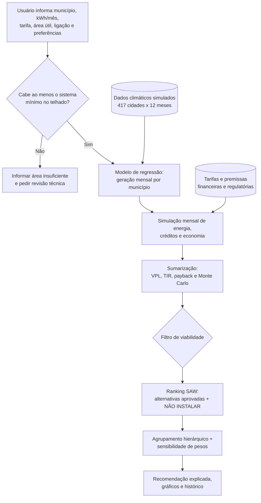

# Diagrama de funcionamento — Sol da Bahia

Para incluir no PDF final, renderize esta imagem Mermaid em um editor compatível ou exporte o diagrama em PNG/SVG. A representação textual acima também pode ser usada para explicar o fluxo no vídeo.
